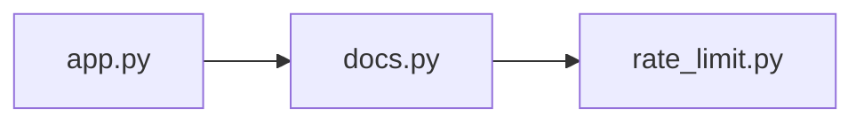

# docs.py

저장소 경로 `backend/src/backend/api/routers/docs.py` 의 관계 노트입니다. `scripts/codegraph.py` 가 생성하므로 직접 수정하지 않습니다.

## imports

- [[graph/backend/src/backend/api/rate_limit|rate_limit.py]]

## imported by

- [[graph/backend/src/backend/api/app|app.py]]

## endpoint

| method | path | handler |
|---|---|---|
| GET | `/docs` | `swagger_ui` |
| GET | `/openapi.json` | `openapi` |

## 함수와 호출

- `_too_many`
- `require_developer`: `backend.api.rate_limit`
- `swagger_ui`
- `openapi`
