# contract.py

저장소 경로 `backend/src/backend/contract.py` 의 관계 노트입니다. `scripts/codegraph.py` 가 생성하므로 직접 수정하지 않습니다.

```mermaid
flowchart LR
  backend_src_backend_contract["contract.py"]
  backend_src_backend_api_app["app.py"] --> backend_src_backend_contract
  backend_src_backend_api_auth_dependency["auth_dependency.py"] --> backend_src_backend_contract
  backend_src_backend_api_job_runner["job_runner.py"] --> backend_src_backend_contract
  backend_src_backend_api_schemas["schemas.py"] --> backend_src_backend_contract
  backend_src_backend_db_models["models.py"] --> backend_src_backend_contract
  backend_src_backend_jobs_auto_assign["auto_assign.py"] --> backend_src_backend_contract
  backend_src_backend_scheduling_slots["slots.py"] --> backend_src_backend_contract
  backend_src_backend_services_notification_notification_service["notification_service.py"] --> backend_src_backend_contract
  backend_src_backend_services_period_period_crud_service["period_crud_service.py"] --> backend_src_backend_contract
  backend_src_backend_services_permission_permission_service["permission_service.py"] --> backend_src_backend_contract
  backend_src_backend_services_roster_roster_service["roster_service.py"] --> backend_src_backend_contract
  backend_src_backend_services_settings_settings_service["settings_service.py"] --> backend_src_backend_contract
  backend_src_backend_services_validation_input["input.py"] --> backend_src_backend_contract
  backend_tests_conftest["conftest.py"] --> backend_src_backend_contract
  backend_tests_integration_db_test_auth_endpoints["test_auth_endpoints.py"] --> backend_src_backend_contract
  backend_tests_integration_db_test_member_expel_endpoints["test_member_expel_endpoints.py"] --> backend_src_backend_contract
  backend_tests_integration_db_test_migration_chain["test_migration_chain.py"] --> backend_src_backend_contract
  backend_tests_integration_db_test_period_service["test_period_service.py"] --> backend_src_backend_contract
  backend_tests_integration_db_test_permission_endpoints["test_permission_endpoints.py"] --> backend_src_backend_contract
  backend_tests_integration_db_test_reject_endpoints["test_reject_endpoints.py"] --> backend_src_backend_contract
  backend_tests_integration_db_test_settings_endpoints["test_settings_endpoints.py"] --> backend_src_backend_contract
  backend_tests_unit_test_permission_rules["test_permission_rules.py"] --> backend_src_backend_contract
```

## imports

- 없음

## imported by

- [[graph/backend/src/backend/api/app|app.py]]
- [[graph/backend/src/backend/api/auth_dependency|auth_dependency.py]]
- [[graph/backend/src/backend/api/job_runner|job_runner.py]]
- [[graph/backend/src/backend/api/schemas|schemas.py]]
- [[graph/backend/src/backend/db/models|models.py]]
- [[graph/backend/src/backend/jobs/auto_assign|auto_assign.py]]
- [[graph/backend/src/backend/scheduling/slots|slots.py]]
- [[graph/backend/src/backend/services/notification/notification_service|notification_service.py]]
- [[graph/backend/src/backend/services/period/period_crud_service|period_crud_service.py]]
- [[graph/backend/src/backend/services/permission/permission_service|permission_service.py]]
- [[graph/backend/src/backend/services/roster/roster_service|roster_service.py]]
- [[graph/backend/src/backend/services/settings/settings_service|settings_service.py]]
- [[graph/backend/src/backend/services/validation/input|input.py]]
- [[graph/backend/tests/conftest|conftest.py]]
- [[graph/backend/tests/integration/db/test_auth_endpoints|test_auth_endpoints.py]]
- [[graph/backend/tests/integration/db/test_member_expel_endpoints|test_member_expel_endpoints.py]]
- [[graph/backend/tests/integration/db/test_migration_chain|test_migration_chain.py]]
- [[graph/backend/tests/integration/db/test_period_service|test_period_service.py]]
- [[graph/backend/tests/integration/db/test_permission_endpoints|test_permission_endpoints.py]]
- [[graph/backend/tests/integration/db/test_reject_endpoints|test_reject_endpoints.py]]
- [[graph/backend/tests/integration/db/test_settings_endpoints|test_settings_endpoints.py]]
- [[graph/backend/tests/unit/test_permission_rules|test_permission_rules.py]]
