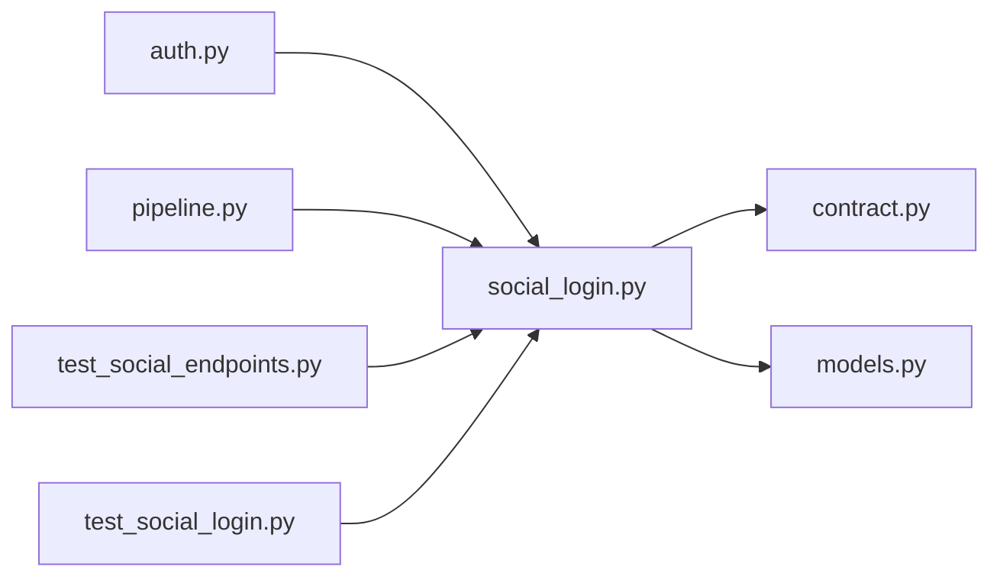

# social_login.py

저장소 경로 `backend/src/backend/services/auth/social_login.py` 의 관계 노트입니다. `scripts/codegraph.py` 가 생성하므로 직접 수정하지 않습니다.

## imports

- [[graph/backend/src/backend/contract|contract.py]]
- [[graph/backend/src/backend/db/models|models.py]]

## imported by

- [[graph/backend/src/backend/api/routers/auth|auth.py]]
- [[graph/backend/src/backend/services/auth/pipeline|pipeline.py]]
- [[graph/backend/tests/integration/db/test_social_endpoints|test_social_endpoints.py]]
- [[graph/backend/tests/unit/test_social_login|test_social_login.py]]

## 함수와 호출

- `provider_config`
- `authorize_url`
- `_http_json`
- `fetch_provider_user_id`
- `find_member`
- `linked_providers`
- `link`: `backend.db.models`
- `unlink_social`
