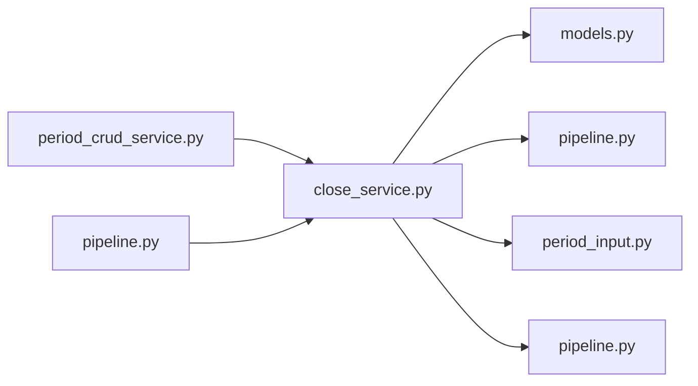

# close_service.py

저장소 경로 `backend/src/backend/services/period/close_service.py` 의 관계 노트입니다. `scripts/codegraph.py` 가 생성하므로 직접 수정하지 않습니다.

## imports

- [[graph/backend/src/backend/db/models|models.py]]
- [[graph/backend/src/backend/services/notification/pipeline|pipeline.py]]
- [[graph/backend/src/backend/services/period/period_input|period_input.py]]
- [[graph/backend/src/backend/services/validation/pipeline|pipeline.py]]

## imported by

- [[graph/backend/src/backend/services/period/period_crud_service|period_crud_service.py]]
- [[graph/backend/src/backend/services/period/pipeline|pipeline.py]]

## 함수와 호출

- `require_naive_close`
- `is_closed`
- `require_not_fixed`
- `require_not_closed`
- `periods_to_fix`
- `require_unavailable_open`: `backend.services.period.period_input`
- `unfix_period`: `backend.services.notification.pipeline`, `backend.services.validation.pipeline`
