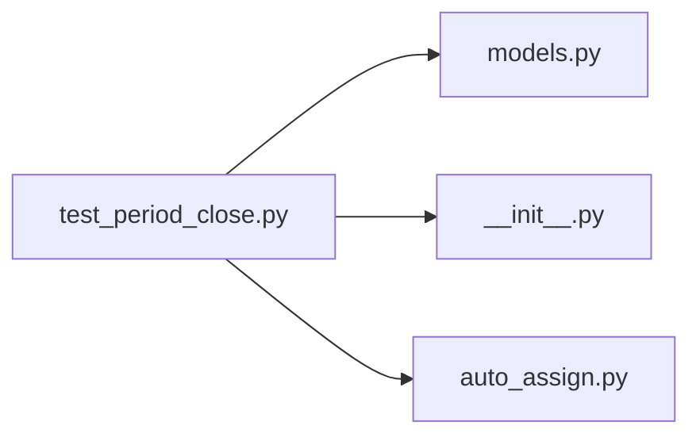

# test_period_close.py

저장소 경로 `backend/tests/integration/db/test_period_close.py` 의 관계 노트입니다. `scripts/codegraph.py` 가 생성하므로 직접 수정하지 않습니다.

## imports

- [[graph/backend/src/backend/db/models|models.py]]
- [[graph/backend/src/backend/jobs/__init__|__init__.py]]
- [[graph/backend/src/backend/jobs/auto_assign|auto_assign.py]]

## imported by

- 없음

## 함수와 호출

- `_period`: `backend.db.models`
- `_team_and_room`: `backend.db.models`
- `test_the_job_fixes_a_period_whose_closing_time_has_passed`: `backend.jobs.auto_assign.run_due_assignments`
- `test_the_job_does_not_fix_before_the_closing_time`: `backend.jobs.auto_assign.run_due_assignments`
- `test_a_fixed_period_is_not_computed_again`: `backend.jobs.auto_assign.run_due_assignments`
- `_closed`
- `_body`
- `test_unavailable_times_inside_a_closed_period_cannot_be_added`
- `test_a_repeating_time_that_reaches_a_closed_period_cannot_be_added`
- `test_unavailable_times_inside_a_closed_period_cannot_be_changed_or_deleted`: `backend.db.models`
- `test_a_fixed_period_rejects_applying_a_record_and_a_manual_run`
- `test_unfixing_clears_the_closing_time_and_tells_every_member_the_reason`
- `test_unfixing_requires_a_reason`
- `test_unfixing_needs_the_record_confirm_permission_and_a_fixed_period`
- `_create_body`
- `test_the_closing_time_is_optional_and_patch_keeps_or_clears_it`
- `test_the_closing_time_of_a_fixed_period_cannot_be_changed`
- `test_a_closing_time_with_a_time_zone_is_rejected`
