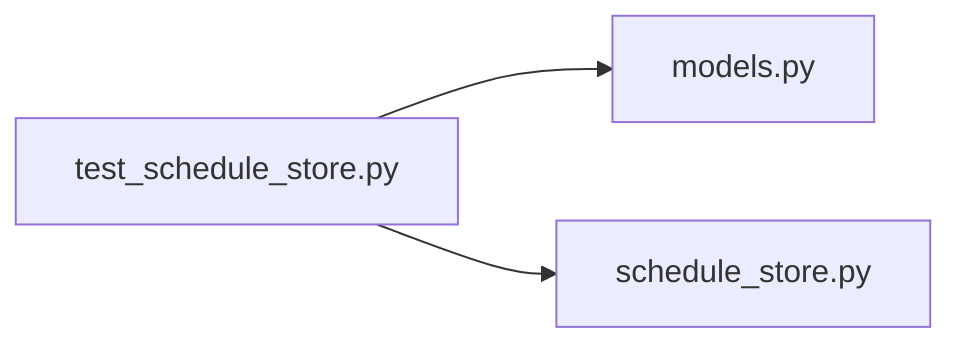

# test_schedule_store.py

저장소 경로 `backend/tests/integration/db/test_schedule_store.py` 의 관계 노트입니다. `scripts/codegraph.py` 가 생성하므로 직접 수정하지 않습니다.

## imports

- [[graph/backend/src/backend/db/models|models.py]]
- [[graph/backend/src/backend/db/schedule_store|schedule_store.py]]

## imported by

- 없음

## 함수와 호출

- `_scaffold`: `backend.db.models`
- `_row`
- `_current`
- `_record_times`: `backend.db.schedule_store`
- `test_assignment_backup_round_trips`: `backend.db.models`
- `test_save_schedule_replaces_the_current_schedule_without_making_a_record`: `backend.db.schedule_store`
- `test_consecutive_slots_become_one_row`: `backend.db.schedule_store`
- `test_a_gap_between_slots_keeps_two_rows`: `backend.db.schedule_store`
- `test_different_teams_are_not_joined`: `backend.db.models`, `backend.db.schedule_store`
- `test_a_record_leaves_the_current_schedule_alone`: `backend.db.schedule_store`
- `test_records_are_listed_newest_first_with_their_slot_counts`: `backend.db.schedule_store`
- `test_only_the_most_recent_records_are_kept`: `backend.db.schedule_store`
- `test_applying_a_record_replaces_the_current_schedule_and_keeps_the_record`: `backend.db.schedule_store`
- `test_applying_a_missing_record_changes_nothing`: `backend.db.schedule_store`
- `test_pruning_one_period_keeps_the_other_periods_records`: `backend.db.models`, `backend.db.schedule_store`
