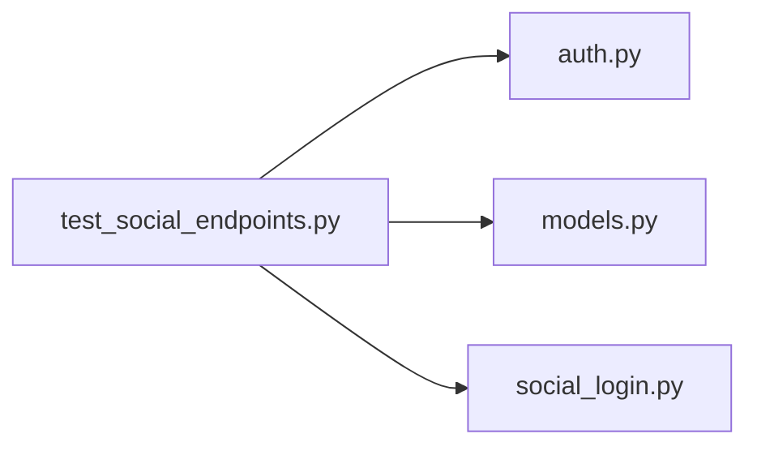

# test_social_endpoints.py

저장소 경로 `backend/tests/integration/db/test_social_endpoints.py` 의 관계 노트입니다. `scripts/codegraph.py` 가 생성하므로 직접 수정하지 않습니다.

## imports

- [[graph/backend/src/backend/api/routers/auth|auth.py]]
- [[graph/backend/src/backend/db/models|models.py]]
- [[graph/backend/src/backend/services/auth/social_login|social_login.py]]

## imported by

- 없음

## 함수와 호출

- `google_enabled`
- `provider_answers`
- `_start`
- `_callback`
- `test_only_configured_providers_are_listed`
- `test_start_redirects_to_google_with_the_state_cookie`
- `test_a_state_that_does_not_match_the_cookie_fails`
- `test_a_denied_consent_without_a_code_fails`
- `test_a_google_state_is_rejected_by_the_kakao_callback`
- `test_a_callback_without_the_state_cookie_fails`
- `test_a_signed_in_member_links_and_then_signs_in_with_google`
- `test_an_unlinked_google_account_cannot_sign_in`
- `test_a_google_account_links_to_one_member_only`
- `test_linking_the_same_provider_twice_is_rejected`
- `test_kakao_is_enabled_by_the_client_id_alone`
- `test_unlinking_removes_the_row_and_keeps_password_sign_in`
- `test_a_unique_violation_at_commit_becomes_the_taken_code`: `backend.services.auth.social_login`
