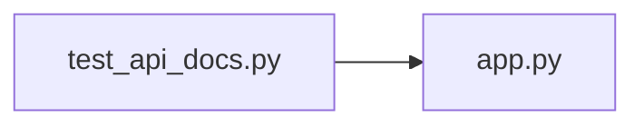

# test_api_docs.py

저장소 경로 `backend/tests/unit/test_api_docs.py` 의 관계 노트입니다. `scripts/codegraph.py` 가 생성하므로 직접 수정하지 않습니다.

## imports

- [[graph/backend/src/backend/api/app|app.py]]

## imported by

- 없음

## 함수와 호출

- `docs_credentials`
- `test_docs_require_the_developer_password`
- `test_openapi_points_requests_at_the_api_root_path`
- `test_docs_are_hidden_when_a_credential_is_not_set`
- `test_docs_block_repeated_guesses`
- `test_docs_block_everyone_after_too_many_failures_from_many_addresses`
- `test_redoc_is_not_served`
