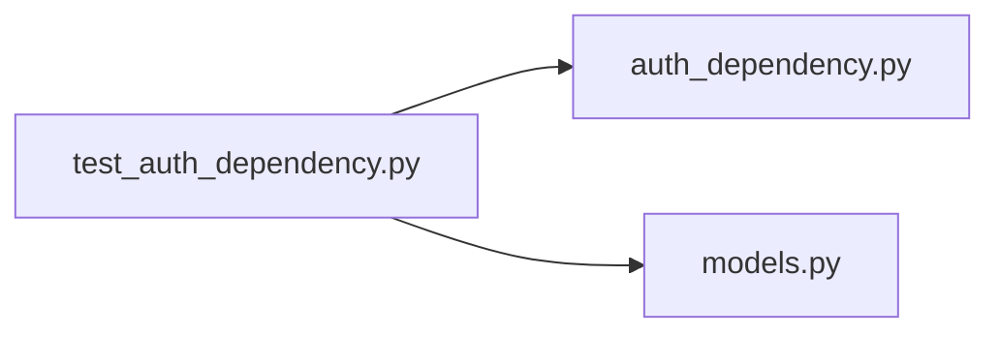

# test_auth_dependency.py

저장소 경로 `backend/tests/unit/test_auth_dependency.py` 의 관계 노트입니다. `scripts/codegraph.py` 가 생성하므로 직접 수정하지 않습니다.

## imports

- [[graph/backend/src/backend/api/auth_dependency|auth_dependency.py]]
- [[graph/backend/src/backend/db/models|models.py]]

## imported by

- 없음

## 함수와 호출

- `_resolve_to`
- `test_a_request_without_the_cookie_is_rejected`: `backend.api.auth_dependency.require_account`
- `test_an_unknown_or_expired_token_is_rejected`: `backend.api.auth_dependency.require_account`
- `test_a_roster_only_member_without_a_password_is_rejected`: `backend.api.auth_dependency.require_account`, `backend.db.models`
- `test_a_signed_up_member_passes`: `backend.api.auth_dependency.require_account`, `backend.db.models`
- `test_a_missing_permission_is_403`: `backend.api.auth_dependency.ensure_permission`, `backend.db.models`
