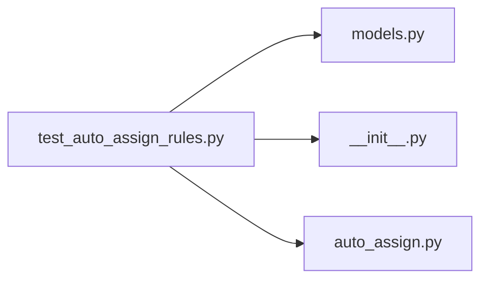

# test_auto_assign_rules.py

저장소 경로 `backend/tests/unit/test_auto_assign_rules.py` 의 관계 노트입니다. `scripts/codegraph.py` 가 생성하므로 직접 수정하지 않습니다.

## imports

- [[graph/backend/src/backend/db/models|models.py]]
- [[graph/backend/src/backend/jobs/__init__|__init__.py]]
- [[graph/backend/src/backend/jobs/auto_assign|auto_assign.py]]

## imported by

- 없음

## 함수와 호출

- `_period`: `backend.db.models`
- `test_only_passed_and_unrun_slots_are_due`: `backend.jobs.auto_assign.due_slots`
- `test_the_job_is_enabled_unless_switched_off`: `backend.jobs.auto_assign.enabled_from_env`
- `test_a_bad_interval_falls_back_to_the_default`: `backend.jobs.auto_assign.interval_seconds_from_env`
- `test_a_finished_check_writes_its_time_for_the_healthcheck`: `backend.jobs.auto_assign.write_heartbeat`
