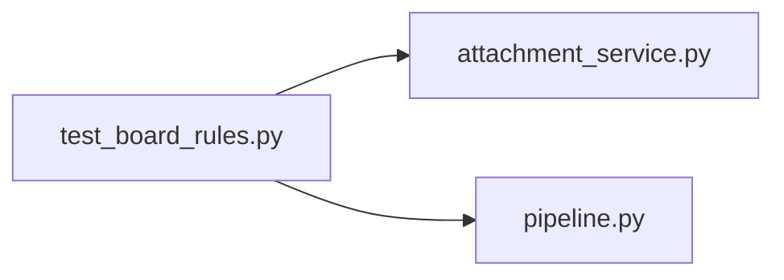

# test_board_rules.py

저장소 경로 `backend/tests/unit/test_board_rules.py` 의 관계 노트입니다. `scripts/codegraph.py` 가 생성하므로 직접 수정하지 않습니다.

## imports

- [[graph/backend/src/backend/services/board/attachment_service|attachment_service.py]]
- [[graph/backend/src/backend/services/storage/pipeline|pipeline.py]]

## imported by

- 없음

## 함수와 호출

- `test_the_extension_is_lowercased_and_checked_against_the_list`: `backend.services.board.attachment_service`
- `test_a_path_in_the_name_is_removed`: `backend.services.storage.pipeline`
- `test_a_stored_name_cannot_point_outside_the_folder`: `backend.services.storage.pipeline`
