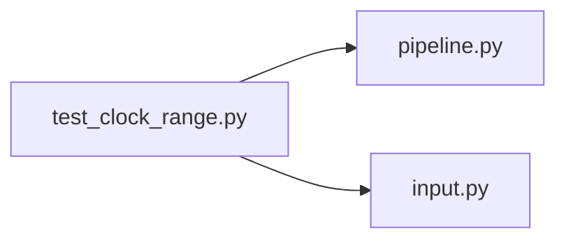

# test_clock_range.py

저장소 경로 `backend/tests/unit/test_clock_range.py` 의 관계 노트입니다. `scripts/codegraph.py` 가 생성하므로 직접 수정하지 않습니다.

## imports

- [[graph/backend/src/backend/scheduling/pipeline|pipeline.py]]
- [[graph/backend/src/backend/services/validation/input|input.py]]

## imported by

- 없음

## 함수와 호출

- `test_a_window_ending_later_the_same_day_stays_on_that_day`: `backend.scheduling.pipeline`
- `test_a_window_ending_at_midnight_ends_on_the_next_day`: `backend.scheduling.pipeline`
- `test_a_range_closing_at_midnight_is_accepted`: `backend.services.validation.input`
- `test_a_range_with_equal_times_is_rejected`: `backend.services.validation.input`
- `test_a_range_past_midnight_other_than_midnight_is_rejected`: `backend.services.validation.input`
- `test_a_reservation_up_to_midnight_fits_a_room_closing_at_midnight`: `backend.services.validation.input`
- `test_a_reservation_past_midnight_is_outside_a_room_closing_at_midnight`: `backend.services.validation.input`
- `test_a_reservation_before_opening_is_outside_the_room_window`: `backend.services.validation.input`
