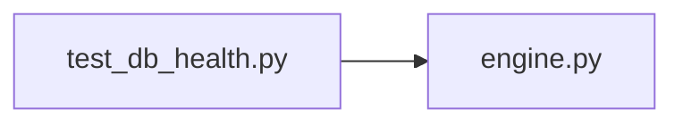

# test_db_health.py

저장소 경로 `backend/tests/unit/test_db_health.py` 의 관계 노트입니다. `scripts/codegraph.py` 가 생성하므로 직접 수정하지 않습니다.

## imports

- [[graph/backend/src/backend/db/engine|engine.py]]

## imported by

- 없음

## 함수와 호출

- `test_connection_failure_does_not_leak_the_driver_message`: `backend.db.engine.check_database`
