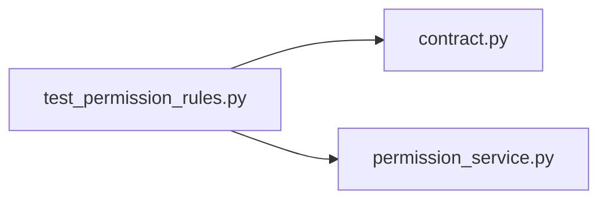

# test_permission_rules.py

저장소 경로 `backend/tests/unit/test_permission_rules.py` 의 관계 노트입니다. `scripts/codegraph.py` 가 생성하므로 직접 수정하지 않습니다.

## imports

- [[graph/backend/src/backend/contract|contract.py]]
- [[graph/backend/src/backend/services/permission/permission_service|permission_service.py]]

## imported by

- 없음

## 함수와 호출

- `test_names_are_deduplicated_and_put_in_declaration_order`: `backend.services.permission.permission_service`
- `test_an_unknown_name_is_refused`: `backend.services.permission.permission_service`
- `test_every_permission_is_needed_to_be_full`: `backend.services.permission.permission_service`
