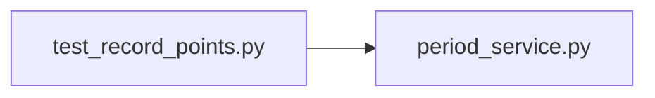

# test_record_points.py

저장소 경로 `backend/tests/unit/test_record_points.py` 의 관계 노트입니다. `scripts/codegraph.py` 가 생성하므로 직접 수정하지 않습니다.

## imports

- [[graph/backend/src/backend/services/period/period_service|period_service.py]]

## imported by

- 없음

## 함수와 호출

- `test_full_target_and_no_absence_is_100`: `backend.services.period.period_service`
- `test_points_are_share_of_target_sessions`: `backend.services.period.period_service`
- `test_sessions_over_target_do_not_cover_other_teams`: `backend.services.period.period_service`
- `test_each_absence_takes_one_point`: `backend.services.period.period_service`
- `test_points_do_not_go_below_zero`: `backend.services.period.period_service`
