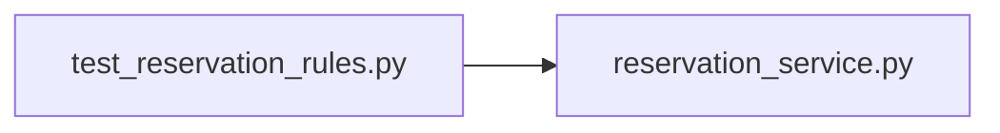

# test_reservation_rules.py

저장소 경로 `backend/tests/unit/test_reservation_rules.py` 의 관계 노트입니다. `scripts/codegraph.py` 가 생성하므로 직접 수정하지 않습니다.

## imports

- [[graph/backend/src/backend/services/reservation/reservation_service|reservation_service.py]]

## imported by

- 없음

## 함수와 호출

- `test_a_reservation_starting_in_the_future_passes`: `backend.services.reservation.reservation_service`
- `test_a_reservation_that_already_started_is_refused`: `backend.services.reservation.reservation_service`
