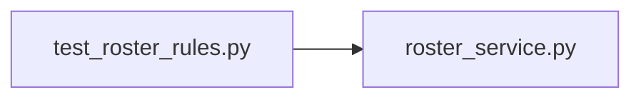

# test_roster_rules.py

저장소 경로 `backend/tests/unit/test_roster_rules.py` 의 관계 노트입니다. `scripts/codegraph.py` 가 생성하므로 직접 수정하지 않습니다.

## imports

- [[graph/backend/src/backend/services/roster/roster_service|roster_service.py]]

## imported by

- 없음

## 함수와 호출

- `test_zero_slots_are_dropped_and_the_rest_kept`: `backend.services.roster.roster_service`
- `test_bad_counts_are_refused`: `backend.services.roster.roster_service`
