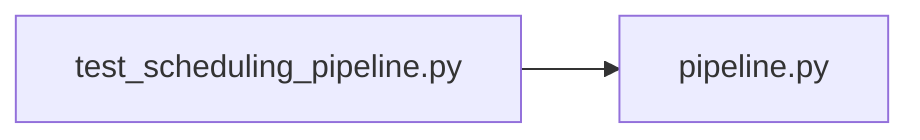

# test_scheduling_pipeline.py

저장소 경로 `backend/tests/unit/test_scheduling_pipeline.py` 의 관계 노트입니다. `scripts/codegraph.py` 가 생성하므로 직접 수정하지 않습니다.

## imports

- [[graph/backend/src/backend/scheduling/pipeline|pipeline.py]]

## imported by

- 없음

## 함수와 호출

- `test_assign_passes_the_solver_limits`: `backend.scheduling.pipeline.assign`
- `test_the_solver_uses_at_most_half_of_the_cores`
