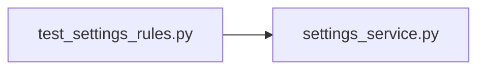

# test_settings_rules.py

저장소 경로 `backend/tests/unit/test_settings_rules.py` 의 관계 노트입니다. `scripts/codegraph.py` 가 생성하므로 직접 수정하지 않습니다.

## imports

- [[graph/backend/src/backend/services/settings/settings_service|settings_service.py]]

## imported by

- 없음

## 함수와 호출

- `test_a_length_that_is_a_multiple_of_the_slot_fits`: `backend.services.settings.settings_service`
- `test_a_length_shorter_than_the_slot_is_refused`: `backend.services.settings.settings_service`
