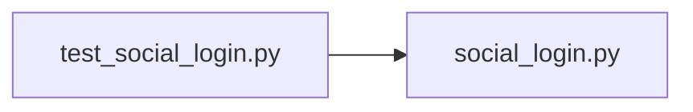

# test_social_login.py

저장소 경로 `backend/tests/unit/test_social_login.py` 의 관계 노트입니다. `scripts/codegraph.py` 가 생성하므로 직접 수정하지 않습니다.

## imports

- [[graph/backend/src/backend/services/auth/social_login|social_login.py]]

## imported by

- 없음

## 함수와 호출

- `test_google_without_a_secret_is_disabled`: `backend.services.auth.social_login`
- `test_kakao_needs_only_the_client_id`: `backend.services.auth.social_login`
- `test_authorize_url_carries_client_redirect_and_state`: `backend.services.auth.social_login`
- `_fake_http`
- `test_the_code_is_exchanged_for_the_user_id`: `backend.services.auth.social_login`
- `test_kakao_integer_id_is_stored_as_text`: `backend.services.auth.social_login`
- `test_a_missing_access_token_is_rejected`: `backend.services.auth.social_login`
- `_google`: `backend.services.auth.social_login`
- `_urlopen_raising`
- `test_provider_failures_become_one_fixed_message`: `backend.services.auth.social_login`
- `test_a_non_object_body_is_rejected`: `backend.services.auth.social_login`
- `test_a_user_id_that_is_not_text_or_a_number_is_rejected`: `backend.services.auth.social_login`
