# queries.ts

저장소 경로 `frontend/src/components/queries.ts` 의 관계 노트입니다. `scripts/codegraph.py` 가 생성하므로 직접 수정하지 않습니다.

```mermaid
flowchart LR
  frontend_src_components_queries["queries.ts"]
  frontend_src_components_queries --> frontend_src_lib_api["api.ts"]
  frontend_src_components_queries --> frontend_src_lib_contract["contract.ts"]
  frontend_src_components_queries --> frontend_src_lib_loading["loading.ts"]
  frontend_src_components_queries --> frontend_src_lib_pipeline["pipeline.ts"]
  frontend_src_components_queries --> frontend_src_lib_roster["roster.ts"]
  frontend_src_components_queries --> frontend_src_lib_teamColors["teamColors.ts"]
  frontend_src_components_AppShell["AppShell.tsx"] --> frontend_src_components_queries
  frontend_src_components_NotificationMenu["NotificationMenu.tsx"] --> frontend_src_components_queries
  frontend_src_components_PostActions["PostActions.tsx"] --> frontend_src_components_queries
  frontend_src_components_PostAttachments["PostAttachments.tsx"] --> frontend_src_components_queries
  frontend_src_components_PostBoard["PostBoard.tsx"] --> frontend_src_components_queries
  frontend_src_components_PostComments["PostComments.tsx"] --> frontend_src_components_queries
  frontend_src_components_TeamSearch["TeamSearch.tsx"] --> frontend_src_components_queries
  frontend_src_components_queries_test["queries.test.ts"] --> frontend_src_components_queries
  frontend_src_routes_Assignment["Assignment.tsx"] --> frontend_src_components_queries
  frontend_src_routes_AssignmentPanels["AssignmentPanels.tsx"] --> frontend_src_components_queries
  frontend_src_routes_Board["Board.tsx"] --> frontend_src_components_queries
  frontend_src_routes_DayDialog["DayDialog.tsx"] --> frontend_src_components_queries
  frontend_src_routes_Notices["Notices.tsx"] --> frontend_src_components_queries
  frontend_src_routes_PostWrite["PostWrite.tsx"] --> frontend_src_components_queries
  frontend_src_routes_Profile["Profile.tsx"] --> frontend_src_components_queries
  frontend_src_routes_ProfileCards["ProfileCards.tsx"] --> frontend_src_components_queries
  frontend_src_routes_Scheduler["Scheduler.tsx"] --> frontend_src_components_queries
  frontend_src_routes_Settings["Settings.tsx"] --> frontend_src_components_queries
  frontend_src_routes_SettingsBlinded["SettingsBlinded.tsx"] --> frontend_src_components_queries
  frontend_src_routes_SettingsEnsemble["SettingsEnsemble.tsx"] --> frontend_src_components_queries
  frontend_src_routes_SettingsMembers["SettingsMembers.tsx"] --> frontend_src_components_queries
  frontend_src_routes_SettingsPeriods["SettingsPeriods.tsx"] --> frontend_src_components_queries
  frontend_src_routes_SettingsReservations["SettingsReservations.tsx"] --> frontend_src_components_queries
  frontend_src_routes_SettingsRooms["SettingsRooms.tsx"] --> frontend_src_components_queries
  frontend_src_routes_SettingsUnavailable["SettingsUnavailable.tsx"] --> frontend_src_components_queries
  frontend_src_routes_Teams["Teams.tsx"] --> frontend_src_components_queries
  frontend_src_routes_UnavailableCalendar["UnavailableCalendar.tsx"] --> frontend_src_components_queries
```

## imports

- [[graph/frontend/src/lib/api|api.ts]]
- [[graph/frontend/src/lib/contract|contract.ts]]
- [[graph/frontend/src/lib/loading|loading.ts]]
- [[graph/frontend/src/lib/pipeline|pipeline.ts]]
- [[graph/frontend/src/lib/roster|roster.ts]]
- [[graph/frontend/src/lib/teamColors|teamColors.ts]]

## imported by

- [[graph/frontend/src/components/AppShell|AppShell.tsx]]
- [[graph/frontend/src/components/NotificationMenu|NotificationMenu.tsx]]
- [[graph/frontend/src/components/PostActions|PostActions.tsx]]
- [[graph/frontend/src/components/PostAttachments|PostAttachments.tsx]]
- [[graph/frontend/src/components/PostBoard|PostBoard.tsx]]
- [[graph/frontend/src/components/PostComments|PostComments.tsx]]
- [[graph/frontend/src/components/TeamSearch|TeamSearch.tsx]]
- [[graph/frontend/src/components/queries.test|queries.test.ts]]
- [[graph/frontend/src/routes/Assignment|Assignment.tsx]]
- [[graph/frontend/src/routes/AssignmentPanels|AssignmentPanels.tsx]]
- [[graph/frontend/src/routes/Board|Board.tsx]]
- [[graph/frontend/src/routes/DayDialog|DayDialog.tsx]]
- [[graph/frontend/src/routes/Notices|Notices.tsx]]
- [[graph/frontend/src/routes/PostWrite|PostWrite.tsx]]
- [[graph/frontend/src/routes/Profile|Profile.tsx]]
- [[graph/frontend/src/routes/ProfileCards|ProfileCards.tsx]]
- [[graph/frontend/src/routes/Scheduler|Scheduler.tsx]]
- [[graph/frontend/src/routes/Settings|Settings.tsx]]
- [[graph/frontend/src/routes/SettingsBlinded|SettingsBlinded.tsx]]
- [[graph/frontend/src/routes/SettingsEnsemble|SettingsEnsemble.tsx]]
- [[graph/frontend/src/routes/SettingsMembers|SettingsMembers.tsx]]
- [[graph/frontend/src/routes/SettingsPeriods|SettingsPeriods.tsx]]
- [[graph/frontend/src/routes/SettingsReservations|SettingsReservations.tsx]]
- [[graph/frontend/src/routes/SettingsRooms|SettingsRooms.tsx]]
- [[graph/frontend/src/routes/SettingsUnavailable|SettingsUnavailable.tsx]]
- [[graph/frontend/src/routes/Teams|Teams.tsx]]
- [[graph/frontend/src/routes/UnavailableCalendar|UnavailableCalendar.tsx]]
