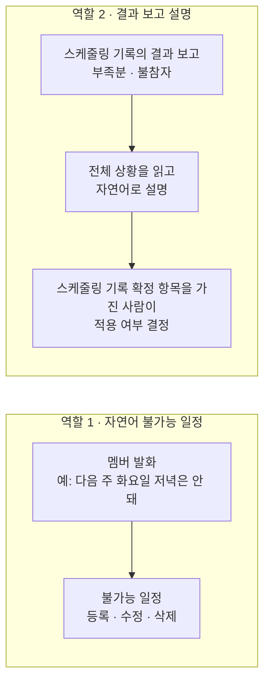

> 문서 버전: 1.2.0 draft

## Abstract

LLM 도우미는 2가지 역할을 합니다. 첫째, 멤버가 자연어로 표현한 불가능 일정을 해석하여 등록·수정·삭제합니다. 둘째, 스케줄링 기록의 결과 보고(부족분, 불참자)를 자연어로 설명하여 스케줄링 기록 확정 항목을 가진 사람이 그 기록을 적용할지 판단하도록 지원합니다. 2번째 역할은 전체 일정 상황을 분석해야 하므로 1번째 역할보다 복잡합니다. 두 역할 모두 미구현입니다.

## Introduction

불가능 일정을 매번 화면에서 직접 입력하는 것은 번거롭고, 자연어로 입력할 수 있으면 입력 시간이 줄어듭니다. 자동 배정은 결과를 항상 내지만, 어느 팀이 왜 목표보다 적게 받았고 누가 왜 빠지는지를 관리자가 보고만 보고 판단하는 것도 부담입니다. LLM 도우미는 이 2가지를 지원하되, 최종 결정은 스케줄링 기록 확정 권한자가 내리도록 설계했습니다.

## Related Work

- [[Banblit|Banblit 개요]] — 전체 기능 지도
- [[auto-assignment/auto-assignment|자동 배정]] — 결과 보고(부족분, 불참자)가 만들어지는 지점
- [[scheduling-api/period-assignment/period-assignment|기간 자동 배정]] — 결과 보고를 조회하고 기록을 적용하는 endpoint
- [[scheduler/scheduler|스케줄러]] — 자연어로 등록한 불가능 일정이 표시되는 화면
- [[accounts-and-roles/accounts-and-roles|계정과 역할]] — 기록 적용을 최종 결정하는 스케줄링 기록 확정 권한자

## Description

### 역할 1 — 자연어로 등록하는 불가능 일정

멤버가 "다음 주 화요일 저녁은 안 돼"처럼 말하면 그 발화를 불가능 일정으로 변환하여 등록하고, 수정과 삭제도 자연어로 처리합니다. 같은 등록·수정·삭제를 화면에서 직접 하는 방법은 [[scheduler/scheduler|스케줄러]]의 내 일정 모드에 있습니다.

### 역할 2 — 결과 보고를 스케줄링 기록 확정 권한자에게 설명합니다

자동 배정은 팀마다 목표 횟수까지 가능한 만큼 배정하고, 결과 보고 2가지를 냅니다(사용자 결정 2026-10-12). 부족분은 목표 시간보다 적게 받은 팀과 그 배정 시간이고, 불참자는 배정된 session 에 불가능 일정이 겹쳐 빠지는 팀원(팀, 포지션, 기수)입니다. slot(점유 단위 길이의 시간 칸)을 서로 교환하여 해결할 수 있는 경우는 [[auto-assignment/auto-assignment|자동 배정]] 계산 내에서 이미 처리되므로, LLM 도우미는 새 배정을 만들지 않고 이 보고를 전체 일정과 팀·멤버 상황과 함께 읽어 "왜 이 팀이 부족한지, 누구의 어떤 불가능 일정 때문에 빠지는지" 를 자연어로 설명합니다. 이전 기획의 조율안(멤버 1명씩 빼고 다시 계산하는 제안)은 2026-10-12 에 삭제되었고, 이 보고가 그 자리를 대신합니다.

설명은 판단 자료일 뿐 기록을 적용할지는 스케줄링 기록 확정 권한자가 결정합니다. 설명의 정확성이 결정 품질을 좌우하므로, 이 역할에는 추론 능력이 우수한 모델을 사용합니다.

### 연동은 아직 방향만 정했습니다

자연어 처리는 Claude API로 연동할 계획이며, 실제 연동은 미구현입니다. Claude API는 사용량 기반 별도 결제이므로 개인 구독과는 독립적입니다. 결과 보고 설명은 보고에 부족분이나 불참자가 있을 때만 호출하면 되므로 호출 횟수는 적지만, 1번의 요청에 전체 일정·팀·멤버 상황을 담은 context(모델에 1번의 요청으로 전달하는 입력 전체)가 필요합니다.

## Conclusion

LLM 도우미는 불가능 일정 입력을 자연어로 받고, 결과 보고를 설명해 스케줄링 기록 확정 권한자가 기록 적용을 결정할 수 있도록 지원합니다. 사용자 간 소통을 다루는 부분은 [[boards/boards|게시판과 공지]]에서 계속됩니다.
