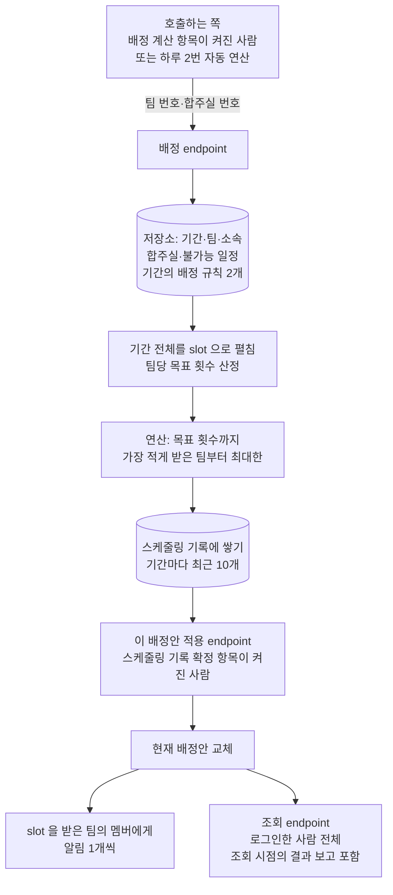

> 문서 버전: 2.3.0 draft



## Abstract

기간 자동 배정은 이미 저장된 기간·팀·소속·합주실·불가능 일정 데이터를 읽어 그 기간 전체의 시간표를 계산하는 endpoint(API의 요청 주소 단위)입니다. 호출하는 쪽은 배정할 팀과 합주실의 번호만 보내면 되고, 나머지(배정 대상 날짜, 팀당 목표 횟수, 화면에 표시할 이름)는 저장된 데이터로부터 이 계층이 채웁니다. 연산 결과는 항상 나오며, 현재 배정안을 바꾸지 않고 "스케줄링 기록" 에 쌓기만 합니다. 현재 배정안은 관리자가 기록 1개를 열어 적용할 때만 바뀌고, 그때만 알림을 보냅니다(사용자 결정 2026-10-13). 결과와 함께 부족분(목표보다 적게 받은 팀)과 불참자(session 에서 빠지는 팀원)를 담은 결과 보고를 반환합니다.

## Introduction

이전의 [[scheduling-api/scheduling-api|스케줄링 API]]는 요청 1번에 팀·멤버·합주실 정보를 전부 담아 보내야 계산할 수 있었습니다. 실제 운영에서는 그 정보가 이미 데이터베이스에 있으므로 매번 다시 보내는 일은 번거롭고 입력 실수가 발생할 수 있습니다. 이 계층은 그 정보를 데이터베이스에서 직접 읽어, 기간 1개를 지정하는 것만으로 계산을 실행합니다.

이 계층이 해결해야 할 문제는 3가지였습니다. 첫째, 계산 엔진은 "기간"이라는 개념을 모르고 하루치 운영시간과 팀 목록만 받으므로 기간의 시작일부터 종료일까지의 모든 날짜를 계산 엔진이 받는 형태로 펼쳐야 합니다. 둘째, 계산 엔진은 번호만 받고 이름은 받지 않으므로 저장소의 번호를 그대로 넘기고 결과가 나오면 화면에 표시할 이름을 그때 붙여야 합니다. 셋째, 연산 결과를 바로 현재 배정안으로 삼으면 부족분이나 불참자가 있는 결과가 관리자 확인 없이 멤버에게 공개되므로, 결과는 기록으로 쌓고 관리자가 고른 기록만 현재 배정안으로 적용해야 합니다. 그 쌓기와 적용은 [[database-layer/schedule-versioning/schedule-versioning|스케줄링 기록]]이 정해 둔 규칙을 그대로 따릅니다.

## Related Work

- [[scheduling-api/scheduling-api|스케줄링 API]] — 이 계층이 재사용하는 계산 호출·오류 응답 규칙의 상위 맥락
- [[database-layer/schedule-versioning/schedule-versioning|스케줄링 기록]] — 기록 쌓기·보관 개수·적용의 실제 규칙. 이 계층은 그 규칙을 호출하기만 합니다
- [[auto-assignment/auto-assignment|자동 배정]] — 계산 엔진 자체의 배정 규칙(목표 횟수까지, 불참 허용 인원)과 결과 보고
- [[accounts-and-roles/accounts-and-roles|계정과 역할]] — endpoint가 요청한 사용자를 확인하는 근거와, endpoint마다 요구하는 권한 항목
- [[practice-room-and-periods/practice-room-and-periods|합주실과 기간]] — 기간의 종류와 "매일" 옵션(종료일이 없는 집중 합주기간)의 뜻
- [[database-layer/database-layer|데이터 저장소]] — 팀·소속·불가능 일정·합주실이 저장되는 table 구조
- [[screens/screens|화면]] — 이 endpoint들을 호출하는 배정 결과 화면

## Description

### endpoint는 5개입니다

| endpoint | 무엇을 하는가 | 부를 수 있는 사람 | 정상 응답 |
| --- | --- | --- | --- |
| 배정 | 팀 번호 목록과 합주실 번호 목록을 받아, 그 기간 전체의 시간표를 계산하고 스케줄링 기록으로 쌓습니다 | 배정 계산 항목이 켜진 사용자 | 연산 결과, 결과 보고, 쌓은 기록의 저장 시각(배정이 0건이면 없음) |
| 조회 | 그 기간의 현재 배정안을 실제 팀 이름·합주실명과 함께 반환합니다 | 로그인한 사용자 전체 | 배정 행 목록(없으면 빈 목록), 예약 가능한 slot, 조회 시점의 결과 보고 |
| 스케줄링 기록 목록 | 그 기간의 기록을 저장 시각, slot 수, 확정 시각, 조회 시점의 점수와 함께 최신순으로 반환합니다 | 스케줄링 기록 확정 항목이 켜진 사용자 | 기록 목록(없으면 빈 목록) |
| 기록 1개 | 기록 1개의 저장 시각을 받아, 그 기록의 시간표와 조회 시점의 결과 보고를 반환합니다 | 스케줄링 기록 확정 항목이 켜진 사용자 | 그 기록의 배정 행 목록과 결과 보고 |
| 이 배정안 적용 | 기록 1개를 현재 배정안으로 복사하고 알림을 보냅니다 | 스케줄링 기록 확정 항목이 켜진 사용자 | 적용했는지 여부 |

현재 배정안을 바꾸는 endpoint 는 "이 배정안 적용" 하나뿐입니다. 배정 endpoint 는 기록만 쌓으므로, 계산은 실행하지만 적용은 하지 못하는 사용자를 둘 수 있습니다. 기록 목록, 기록 1개, 적용 3개 endpoint 는 같은 권한 항목(스케줄링 기록 확정) 하나로 검증합니다(사용자 결정 2026-10-13). 목록에서 기록을 열고 적용하는 것이 한 흐름이라, 권한이 나뉘면 목록만 보이고 열거나 적용하지 못하는 상태가 생기기 때문입니다. 이전의 되돌리기 endpoint 와 조율안 확정 endpoint 는 삭제되었습니다. 권한 항목이 무엇이고 어떻게 켜고 끄는지는 [[accounts-and-roles/accounts-and-roles|계정과 역할]]에 작성되어 있는 내용을 기준으로 하고, 계산 완료 여부를 polling(주기적으로 서버에 같은 요청을 다시 보내 변경을 확인하는 방식)하는 endpoint까지 포함한 전체 규칙과 401·403을 구분하는 이유는 [[scheduling-api/scheduling-api|스케줄링 API]]에 있습니다.

기록 목록, 기록 1개, 적용 3개 endpoint 의 주소는 "기록(records)" 이라는 이름을 씁니다. 화면 문구 "스케줄링 기록" 과 같은 이름입니다(사용자 결정 2026-10-15). 저장소의 table 이름은 바꾸지 않았습니다.

5개 endpoint 모두 기간 번호 1개를 기준으로 동작합니다. 배정 endpoint는 집중 합주기간에서만 실행할 수 있고, 그 밖의 기간에는 자동 배정 자체가 적용되지 않으므로 계산 전에 거부합니다.

### 기간 전체를 날짜와 합주실로 펼칩니다

배정 대상 날짜는 기간의 "매일" 옵션에 따라 다릅니다(사용자 결정 2026-09-11). 옵션이 꺼진 기간은 시작일부터 종료일까지 양 끝을 포함한 모든 날입니다. 옵션이 켜진 기간은 종료일이 없으므로, 계산을 실행한 날(저장 시각의 날짜) 하루만 배정 대상입니다. 남는 slot 을 조회할 때도 같은 규칙을 적용하며, 이때의 "실행한 날" 은 조회한 날입니다. 옵션이 켜진 기간에 저장된 종료일은 참조하지 않습니다. 옵션이 켜진 기간이 예약을 어떻게 거절하는지는 [[practice-room-and-periods/practice-room-and-periods|합주실과 기간]]에서 다룹니다.

날짜 목록이 정해지면 요청에 담긴 합주실 1개마다 그 날짜 수만큼 늘립니다. 계산 엔진은 합주실 1개에 연속한 운영시간 1개만 받으므로, 같은 합주실이라도 날짜가 다르면 서로 다른 합주실로 계산에 넘겨야 하기 때문입니다. 예를 들어 합주실이 2개, 기간이 2주(14일)면 계산 엔진에는 28개의 합주실이 들어갑니다. 이렇게 늘어난 합주실 각각의 운영시간을 1시간 slot으로 나눈 결과가 그 기간의 전체 slot입니다.

팀당 목표 횟수는 기간의 배정 규칙 2개 중 "팀당 목표 시간" 이 정합니다(사용자 결정 2026-10-12). 값이 있으면 그 시간을 session 횟수로 바꾸고, 비어 있으면 전체 session 자리 수를 팀 수로 나눈 값을 씁니다. 어느 쪽이든 "날짜 수 × 하루에 들어가는 session 수" 를 넘지 않게 줄입니다. 나머지 시간은 배정하지 않는 남는 slot 이 됩니다. 목표 시간이 비어 있고 팀 수가 전체 자리 수보다 많아 팀마다 1회도 줄 수 없는 경우에는 계산을 시작하지 않고 거부하고, 배정할 팀이 0개인 요청도 같은 방식으로 거부합니다.

다른 하나인 "불참 허용 인원" 은 session 1회에서 불가능 일정 때문에 빠져도 되는 팀원 수의 상한입니다(기본 0). 두 값은 기간에 저장되고(migration `c7d2e5a18f40`), 설정 화면의 기간 form 에서 입력합니다. 계산 엔진이 두 값을 어떻게 쓰는지는 [[auto-assignment/auto-assignment|자동 배정]]에 있습니다.

### 저장소의 번호를 그대로 계산에 넘깁니다

계산 엔진은 팀·합주실·사람을 번호로만 구분합니다. 이 계층은 저장소에서 번호를 읽으므로 별도의 식별자를 생성할 필요가 없습니다.

```
저장소                        계산                       응답
합주실 7번 "1번방"     ──►    합주실 7 × 날짜마다   ──►   7번 + "1번방"
사람 12번 "김민수"     ──►    사람 12              ──►   12번 + "김민수"
사람 34번 "김민수"     ──►    사람 34              ──►   34번 + "김민수"
```

동명이인은 저장소에서 이미 다른 번호이므로 계산에서도 다른 사람입니다. 같은 사람이 2개 이상 팀에 속해 있으면 번호가 1개뿐이라, 계산은 그 사람이 같은 시간에 2개 팀에 동시에 배정될 수 없다는 조건을 적용합니다.

같은 합주실이 날짜마다 다시 사용되어도 번호를 나눌 필요가 없습니다. slot 1개는 합주실 번호와 시작 시간 2개 값으로 식별하므로, 같은 합주실이라도 날짜가 다르면 slot도 다릅니다. 이름은 계산에 들어가지 않고, 결과를 반환할 때 저장소에서 읽어 둔 이름을 번호에 붙여 반환합니다.

멤버가 등록한 불가능 일정 중 매주 반복으로 표시된 불가능 일정은 그 기간 안에서 실제로 겹치는 구간으로 전개하여 계산에 넘깁니다. 반복은 7일 간격으로 되풀이하되 반복 종료일이 정해져 있으면 그 날짜까지만 만들고, 기간과 겹치지 않는 구간은 만들지 않습니다. 계산에 넘겨도 결과에 영향이 없는 값을 넘길 이유가 없기 때문입니다.

### 연산 결과는 스케줄링 기록으로만 쌓습니다 (2026-10-13)

연산은 항상 결과를 냅니다. 계산 엔진이 "목표 횟수까지, 가장 적게 받은 팀부터 최대한" 배정하므로 조건을 충족하는 시간표가 없는 경우가 생기지 않습니다. 수동 연산(배정 endpoint)과 하루 2번 자동 연산이 같은 순서 하나를 부르고, 그 순서는 다음과 같습니다.

```
연산 ──▶ 결과 보고 계산 ──▶ 스케줄링 기록에 쌓기 ──▶ 응답(결과, 보고, 기록의 저장 시각)
                               │
                               └─ 현재 배정안은 그대로, 알림 없음
```

기록은 같은 저장 시각을 가진 행 묶음 1개이고, 기간마다 최근 10개만 남깁니다. 자동 연산이 하루 2번이라 5일치입니다. 배정이 0건이면 쌓을 행이 없어 기록을 남기지 않고, 응답의 저장 시각도 비어 있습니다. 보관 규칙은 [[database-layer/schedule-versioning/schedule-versioning|스케줄링 기록]]에 있습니다.

### 결과 보고: 부족분과 불참자 (2026-10-12)

결과 보고는 시간표 1개를 보고 2가지를 알려 줍니다.

| 항목 | 뜻 | 담는 값 |
| --- | --- | --- |
| 부족분 | 팀당 목표 시간보다 적게 받은 팀 | 팀, 배정 시간 |
| 불참자 | 배정된 session 에 불가능 일정이 겹쳐 빠지는 팀원 | 팀, 멤버(번호, 이름, 기수, 포지션), 빠지는 session 수 |
| 허용 인원 초과 | session 1회라도 빠지는 인원이 불참 허용 인원을 넘었는가 | 참, 거짓 |

보고는 저장하지 않습니다. 현재 배정안 조회와 기록 1개 조회는 매번 그 시점의 불가능 일정으로 보고를 다시 계산합니다. 연산 뒤 멤버가 불가능 일정을 추가하면 같은 시간표의 보고가 달라질 수 있고, 화면은 이 값으로 현재 배정안 경고를 표시합니다(허용 인원 초과가 참일 때). 이전의 조율안(멤버 1명씩 빼고 다시 계산하는 제안)은 삭제되었고 이 보고가 그 자리를 대신합니다.

### 이 배정안 적용 (2026-10-13)

관리자는 기록 목록에서 기록 1개를 열어 시간표와 보고를 확인한 뒤 적용합니다. 적용은 그 기록의 행을 현재 배정안으로 복사하는 것이고, 기록은 목록에 남아 다시 적용할 수 있습니다. 적용 전 현재 배정안은 따로 보관하지 않습니다. 현재 배정안은 언제나 기록 1개를 적용한 것이라 같은 시간표가 목록에 남아 있기 때문입니다. 이전 확정본과 되돌리기는 이 이유로 삭제되었습니다.

**점수와 확정 표시 (사용자 결정 2026-10-15).** 적용한 배정안의 합주 시간 전부에 한 팀원이 불가능 일정을 넣으면, session 마다 불참자는 1명이라 초과 경고가 뜨지 않은 채 그 팀원이 계속 빠집니다. 같은 시점의 연산 기록에는 그 팀원이 참석하는 더 나은 배정안이 있으므로, 관리자가 이를 비교할 수 있게 기록마다 점수를 붙입니다.

| 점수 항목 | 뜻 | 좋은 방향 |
| --- | --- | --- |
| 팀 최소 | 가장 적게 받은 팀의 session 수 | 많을수록 |
| 전체 | 전체 session 수 | 많을수록 |
| 불참 | session 마다 빠지는 인원의 합 | 적을수록 |
| 연속 | 같은 팀이 같은 합주실에서 바로 이어 쓰는 session 쌍 수 | 많을수록 |

항목은 계산 엔진의 목적식과 같은 순서로 우선합니다. 점수는 저장하지 않고 목록을 조회할 때마다 지금의 불가능 일정으로 매기므로, 불가능 일정이 바뀌면 모든 기록의 점수가 함께 바뀝니다. 점수가 더 높은 기록이 있어도 자동으로 적용하지 않습니다. 적용은 관리자가 확인창을 거쳐 누를 때만 일어나고, 그때 기록에 확정 시각을 남깁니다. 다시 적용하면 확정 시각은 최근 시각으로 바뀝니다.

```
스케줄링 기록 목록              기록 1개                         현재 배정안
──────────────────      ──────────────────────────      ─────────────
10월 13일 21:00  ──▶  시간표 + 조회 시점 결과 보고  ──적용──▶  교체 + 알림
 (칸 12개, 점수)
10월 13일 09:00
 (칸 10개, 점수, 10월 13일 확정)
```

기록을 식별하는 값은 **저장 시각**입니다. 기록에는 별도의 번호가 없고, 연산 1회의 행들이 같은 저장 시각을 공유합니다. 그 저장 시각의 행이 0개이면 "빈 기록" 이 아니라 "존재하지 않는 기록" 이므로, 조회와 적용 모두 거절합니다.

### 현재 배정안이 바뀐 뒤에만 알림을 생성합니다

현재 배정안이 바뀌는 경우는 "이 배정안 적용" 하나뿐이므로 알림도 그 endpoint 에서만 생성합니다. 그 기간에 slot 을 받은 팀의 멤버에게 알림 1개씩입니다. 수동 연산과 자동 연산은 기록만 쌓으므로 알림을 남기지 않습니다.

```
수동 연산 ─┐
자동 연산 ─┴─▶ 기록만 쌓는다 ─▶ 알림 없음

이 배정안 적용 ─▶ 현재 배정안 교체 ─▶ slot 을 받은 팀의 멤버에게 알림
              └─ 기록 없음 · 다른 기간과 겹침 ─▶ 거절, 아무것도 안 남긴다
```

알림 대상과 종류는 [[auto-assignment/auto-assignment|자동 배정]]에 작성되어 있는 내용을 기준으로 합니다.

### 거부하는 경우

배정 계산을 시작하기 전에 다음 입력은 거부합니다.

| 입력 | 거부 사유 |
| --- | --- |
| 그런 기간·팀·합주실 번호가 없음 | 존재하지 않는 대상을 배정할 수 없습니다 |
| 집중 합주기간이 아닌 기간에 배정을 요청함 | 자동 배정은 집중 합주기간에서만 실행됩니다 |
| 팀 번호 목록에 같은 번호가 2번 들어옴 | 오류 메시지 없이 1개로 합쳐지면 실제로 몇 팀이 배정 대상인지 알 수 없게 됩니다 |
| 합주실 번호 목록에 같은 번호가 2번 들어옴 | 위와 같은 이유 |
| 팀당 목표 시간이 비어 있고, 팀마다 1회도 배정할 수 없을 만큼 자리가 부족함 | 계산 자체가 의미 없는 요청입니다 |
| 소속 멤버가 없는 팀이 포함됨 | 멤버가 0명인 팀에 slot을 배정할 수 없습니다 |

자동 배정과 화면의 스케줄링 버튼은 멤버가 1명 이상 있는 모든 팀과 모든 합주실을 계산에 넣습니다. 그래서 위의 "소속 멤버가 없는 팀" 거부는 팀 번호를 직접 지정해 요청할 때만 발생합니다. 2026-10-16 이전에는 스케줄링 버튼이 현재 배정안에 나온 팀과 합주실만 넣어, 그 뒤에 만든 팀은 다시 계산해도 배정받지 못했습니다. 확인은 `frontend/e2e/assignment.spec.ts` 의 "다시 계산하면" 테스트(보낸 팀·합주실 목록)와 `backend/tests/integration/db/test_period_service.py` 의 `test_every_team_and_room_skips_teams_without_members` 가 합니다.

적용 시점에 발생하는 거부도 1가지 있습니다. 다른 기간이 이미 같은 합주실의 같은 시각을 현재 배정안으로 사용하고 있으면 "이 배정안 적용" 이 422 로 거부됩니다. 연산은 기록만 쌓고 기록 table 에는 겹침 금지 제약이 없으므로, 이 충돌은 연산이 아니라 적용에서만 일어납니다. 집중 합주기간끼리는 날짜가 겹칠 수 없으므로(migration `b5e1d9a37c42`), 기간의 날짜를 변경해 옛 날짜의 기록이 남고 그 날짜에 새 기간을 만들어 같은 합주실을 적용한 뒤 옛 기록을 적용하면 발생합니다. 이 경우 기간을 겹치지 않게 하거나 합주실을 나누라는 안내와 함께 거부하고, 다른 기간의 현재 배정안과 이 기간의 현재 배정안은 그대로 유지됩니다.

### 어떻게 확인했나

이 계층도 실패하는 테스트를 먼저 작성한 뒤 통과시키는 방식으로 만들었습니다.

| 테스트 파일 | 커버하는 시나리오 |
| --- | --- |
| `backend/tests/unit/test_period_input.py` | 기간의 모든 날짜를 빠짐없이 포함하는지, 불가능 일정의 매주 반복이 기간 안에서 올바르게 전개되는지, 합주실이 날짜 수만큼 저장소 번호를 유지한 채 늘어나는지, 팀당 목표 횟수가 목표 시간이 비어 있으면 자동값으로, 있으면 시간을 session 횟수로 바꾼 값으로 정해지고 하루 상한으로 줄어드는지, 자리가 부족하거나 배정할 팀이 없을 때 거부되는지, 동명이인이 서로 다른 번호로 구분되는지 |
| `backend/tests/integration/db/test_period_service.py` | 연산이 기록으로만 쌓이고 현재 배정안을 바꾸지 않는지, 연산할 때마다 기록이 1개씩 쌓이는지, 목표를 채우지 못한 결과가 기록으로 쌓이고 부족분이 보고되는지, 허용된 불참자가 포지션과 기수와 함께 보고되는지, 허용 인원을 넘는 session 을 보고가 표시하는지, 기간의 팀당 목표 시간이 자동값을 대신하는지, 집중이 아닌 기간·존재하지 않는 기간/팀/합주실·소속 없는 팀·중복 번호가 거부되는지, 다른 기간과 같은 합주실·시각이 겹치면 500 이 아니라 거부되는지, 2주 × 합주실 2개 × 팀 4개 규모가 끝까지 계산되는지, "매일" 옵션이 켜진 기간이 계산을 실행한 날 하루만 배정하는지 |
| `backend/tests/integration/db/test_schedule_store.py` | 기록이 현재 배정안을 바꾸지 않는지, 기록이 최신순으로 slot 수와 함께 나열되는지, 최근 10개만 남는지, 적용이 현재 배정안을 교체하고 기록은 남기는지, 없는 기록의 적용이 아무것도 바꾸지 않는지, 한 기간의 정리가 다른 기간의 기록을 남기는지 |
| `backend/tests/integration/db/test_period_endpoints.py` | 조회 응답이 아직 배정이 없을 때 빈 목록을 반환하는지, 현재 배정안을 실제 팀·합주실명과 함께 반환하는지, 다른 기간의 배정이 섞이지 않는지, 목표를 채우지 못한 결과의 부족분이 실제 이름으로 반환되고 기록으로 쌓이는지, 오래된 기록을 적용하면 정확히 그 기록이 현재 배정안이 되는지, 다른 기간과 겹치는 기록의 적용이 422 로 거부되는지, 기록 목록·기록 1개·적용이 스케줄링 기록 확정 항목을 요구하는지, 적용한 기록이 목록에 남는지, 되돌리기 endpoint 와 옛 조율안 확정 endpoint 가 존재하지 않는지 |
| `backend/tests/integration/db/test_notifications.py` | 기록을 적용할 때만 알림이 남는지, 연산 버튼을 누른 것만으로는 알림이 남지 않는지 |
| `backend/tests/integration/db/test_migration_chain.py` | migration 전체(`c7d2e5a18f40`, `e4a9b7c2d150` 포함)를 base 까지 되돌릴 수 있는지 |
| `backend/tests/unit/test_db_engine.py` | 접속 주소가 설정되지 않았을 때 즉시 실패하는지, 같은 주소로 2번 호출했을 때 같은 engine을 반환하는지 |

실행 커맨드(저장소 루트에서):

```
docker compose run --rm dev pytest tests/unit/test_period_input.py tests/integration/db/test_period_service.py tests/integration/db/test_schedule_store.py tests/integration/db/test_period_endpoints.py tests/integration/db/test_notifications.py tests/integration/db/test_migration_chain.py -q
```

전체 스위트는 다음 명령으로 실행합니다.

```
docker compose run --rm dev pytest -q
```

타입 표기는 `docker compose run --rm --no-deps dev mypy` 로 따로 확인합니다.

### 성능을 함께 측정했습니다

2주(14일) × 합주실 2개 × 팀 4개 규모의 배정 계산이 실제로 끝까지 도는지와 얼마나 걸리는지를 같은 테스트로 함께 확인했습니다. 이 규모는 하루 4시간씩 운영하는 합주실 2개를 2주 동안 4개 팀이 나눠 쓰는 상황에 해당합니다.

측정은 `pytest`의 `--durations` 옵션으로 했습니다. 이 옵션은 테스트가 끝난 뒤 실행 시간이 긴 테스트부터 순서대로 나열해 보여주는데, `--durations=5`처럼 숫자를 주면 가장 느린 5개만 보여주고 옵션을 생략하면 이 목록 자체가 출력되지 않습니다.

```
docker compose run --rm dev pytest -q --durations=5
```

이 규모의 배정 테스트 1개가 계산에 쓴 시간은 0.08초였고, 같은 실행에서 전체 테스트는 약 2초에 끝났습니다.

**운영 데이터 규모 측정 (2026-10-15).** 실제 운영에 가까운 입력으로 다시 측정했습니다. 팀 13개, 합주실 1개, 14일, 반복 불가능 일정 110건입니다. 불참 허용 인원 0~2명과 개선 대기 시간 3초, 5초, 10초를 조합한 9가지를 모두 돌렸습니다.

| 측정 항목 | 결과 |
| --- | --- |
| 가장 적게 받은 팀의 session 수 | 9가지 모두 5회 |
| 전체 session 수 | 9가지 모두 65회 |
| 불참 인원 | 9가지 모두 0명 |
| 계산 시간 | 3.2~14.4초 |
| 계산 thread 를 코어 수의 절반으로 줄였을 때 | 결과와 시간 모두 같음 |

개선 대기 시간은 더 나은 답을 찾지 못한 채 이 시간이 지나면 계산을 멈추는 기준입니다. 3초에서도 결과가 같았지만 여유를 두어 5초로 유지합니다. 계산은 api 와 같은 process 에서 실행되므로 thread 수를 코어 수의 절반으로 제한합니다. 코어 전부를 쓰면 계산하는 동안 다른 요청이 느려집니다.

### 트러블슈팅

**문제 1 — 실제로는 겹치지 않는 합주실명을 겹친다고 오판함**

- **언제**: 합주실 × 날짜 펼치기를 구현하던 중, 방어 차원에서 "생성된 표시가 다른 합주실의 원래 이름과 우연히 같아지는 경우"까지 막는 검사를 추가한 직후
- **어디서**: 합주실명에 날짜 꼬리표를 붙이는 부분
- **무엇이 벌어졌나**: 예를 들어 "1번방"이라는 합주실과 "1번방 (2026-08-01)"이라는 합주실이 함께 요청에 들어오면 앞의 합주실이 8월 1일에 만드는 표시("1번방 (2026-08-01)")가 뒤의 합주실의 원래 이름과 글자 그대로 같아집니다. 이 경우를 막으려고 추가한 검사가 이런 입력을 전부 "이름이 겹친다"며 거부했습니다
- **왜 그런가**: 실제로 계산 엔진에 넘어가는 표시는 "1번방 (2026-08-01)"과 "1번방 (2026-08-01) (2026-08-01)"로 서로 다릅니다. 날짜 꼬리표는 길이가 항상 고정이고 합주실명은 저장 단계에서 이미 서로 달라야 하는 값이라 2개 합주실의 표시가 실제로 같아질 방법이 없어서, 겹칠 수 없는 경우를 겹친다고 잘못 판단한 오탐이었습니다
- **어떻게 해결했는지**: 이 방어 검사를 삭제했습니다. 실제로 표시끼리 같아지는 입력을 재현할 수 없다는 것을 확인한 뒤, "겹쳐 보이지만 거부되면 안 되는" 입력을 테스트로 남겨 같은 오판이 재발하지 않게 했습니다
- **남는 영향**: 없습니다. 이후 계산 엔진이 이름 대신 저장소의 번호를 그대로 받도록 변경되면서 날짜 꼬리표 자체가 사라졌고, 이 문제가 속한 부류도 함께 없어졌습니다

**문제 2 — 기간이 겹치는 두 요청이 저장 단계에서 500 오류로 노출됨**

- **언제**: 다른 기간이 이미 같은 합주실·같은 시각을 쓰고 있을 때의 동작을 검증하던 중
- **어디서**: 계산이 끝난 배정 결과를 현행 시간표로 저장하는 부분
- **무엇이 벌어졌나**: 두 집중 합주기간의 날짜가 겹치고 같은 합주실을 함께 배정 대상으로 지정하면 저장 시점에 "합주실 + 시작 시간" 중복을 막는 제약에 걸렸고, 이 제약 위반이 그대로 처리되지 않고 서버 내부 오류(500)로 드러났습니다
- **왜 그런가**: 저장 계층의 중복 방지 제약은 [[database-layer/database-layer|데이터 저장소]]가 이미 정해 둔 검증인데, 이 계층은 그 제약에 위반될 수 있는 상황을 미리 검증하지 않고 있었습니다. 사용자가 실제로 만들 수 있는 입력 실수인데도 그 실수를 안내하는 대신 원인을 알 수 없는 서버 오류로 반환하고 있었습니다
- **어떻게 해결했는지**: 저장 중 이 제약 위반이 발생하면 즉시 롤백하고, "다른 기간이 이미 같은 합주실의 같은 시간을 사용하고 있습니다"는 문구와 함께 사용자 오류로 변경해 응답합니다. 같은 수정에서 요청에 같은 팀·합주실 번호가 중복으로 들어오면 오류 메시지 없이 1개로 합쳐지던 동작도 미리 거부하도록 함께 수정했습니다
- **남는 영향**: 겹치는 기간이 같은 합주실을 함께 지정하는 요청은 이제 사용자 오류로 안내되며, 먼저 저장된 기간의 현행 시간표는 이 실패로 인해 변경되지 않습니다

**문제 3 — 요청마다 데이터베이스 engine을 새로 생성하고 있었음**

- **언제**: 3개 endpoint를 다 만든 뒤 전체를 1번에 검토하던 중
- **어디서**: endpoint가 요청마다 DB session을 받는 부분
- **무엇이 벌어졌나**: 요청이 들어올 때마다 engine(데이터베이스 접속 설정과 connection pool을 가진 객체)을 처음부터 다시 생성하고 있었습니다. engine 1개에는 실제 접속을 2개 이상 보관하는 connection pool(접속 풀)이 있어서 요청이 쌓이면 사용하지 않는 접속이 계속 늘어나고, 결국 데이터베이스가 허용하는 접속 수를 넘겨 서버가 중지됩니다
- **왜 그런가**: engine을 생성하는 함수는 원래 "호출할 때마다 새로 생성한다"는 전제로 작성되었고, 요청마다 호출되는 위치에서 그대로 사용하면서 문제가 발생했습니다. 모든 테스트가 이 함수를 테스트 전용 접속으로 교체하기 때문에 실제로는 1번도 실행된 적이 없어 테스트로는 드러나지 않았습니다
- **어떻게 해결했는지**: engine을 1번만 생성하고 다시 호출할 때는 같은 engine을 반환하도록 변경했습니다. "설정이 없으면 즉시 실패한다"는 기존 규칙은 그대로 유지했고, 2개 동작을 모두 검증하는 테스트를 새로 만들었습니다
- **남는 영향**: 없습니다. 다만 engine이 1개만 존재하게 되었으므로 나중에 접속 주소를 실행 중에 변경해야 할 일이 생기면 그 부분을 다시 검토해야 합니다

**문제 4 — 되돌리기에도 같은 500 오류가 남아 있었음**

- **언제**: 문제 2를 수정한 뒤 전체를 1번에 검토하던 중
- **어디서**: 되돌리기 endpoint
- **무엇이 벌어졌나**: 문제 2에서 배정 endpoint에는 검증을 추가했는데 되돌리기 endpoint에는 추가하지 않아서, 다른 기간이 그 합주실·그 시각을 차지한 뒤에 되돌리기를 호출하면 똑같이 서버 오류가 발생했습니다
- **왜 그런가**: 되돌리기도 같은 table에 이전 시간표를 다시 저장하는 동작이라 배정과 완전히 같은 제약에 위반됩니다. 한쪽만 수정하면 다른 쪽이 남는다는 것을 처음에 발견하지 못했습니다
- **어떻게 해결했는지**: 2개 endpoint가 같은 판별과 같은 안내 문구를 사용하도록 1곳으로 모았습니다. 아울러 문제 2에서 추가한 판별이 다른 원인의 저장 실패까지 같은 안내로 대체하고 있었으므로, 실제로 어떤 상황에서 무엇이 담기는지 컨테이너에서 직접 확인해 판별을 좁혔습니다
- **남는 영향**: 데이터베이스가 반환하는 정보만으로는 "다른 기간이 차지함"과 "같은 기간에 대해 2개 요청이 동시에 저장을 시도함"을 구분할 수 없다는 것을 확인했습니다. 그래서 안내 문구를 2가지 경우 모두에 맞도록 작성했고, 완전한 구분은 미구현입니다. 되돌리기는 2026-10-13 에 삭제되었고, 같은 판별과 안내 문구를 지금은 "이 배정안 적용" 이 사용합니다

## Conclusion

기간 자동 배정은 저장된 기간·팀·합주실 데이터를 계산 엔진이 요구하는 형태로 펼치는 변환 작업과, 연산 결과를 스케줄링 기록으로 쌓고 관리자가 고른 기록만 현재 배정안으로 적용하는 연결 작업으로 이루어집니다. 계산의 규칙은 [[auto-assignment/auto-assignment|자동 배정]]에서, 기록과 적용의 규칙은 [[database-layer/schedule-versioning/schedule-versioning|스케줄링 기록]]에서 각각 그대로 사용할 뿐, 이 계층이 새로 만드는 규칙은 날짜·이름을 펼치는 부분, 기간의 배정 규칙 2개로 팀당 목표 횟수를 정하는 부분, 결과 보고를 조회 시점에 다시 계산하는 부분입니다.
