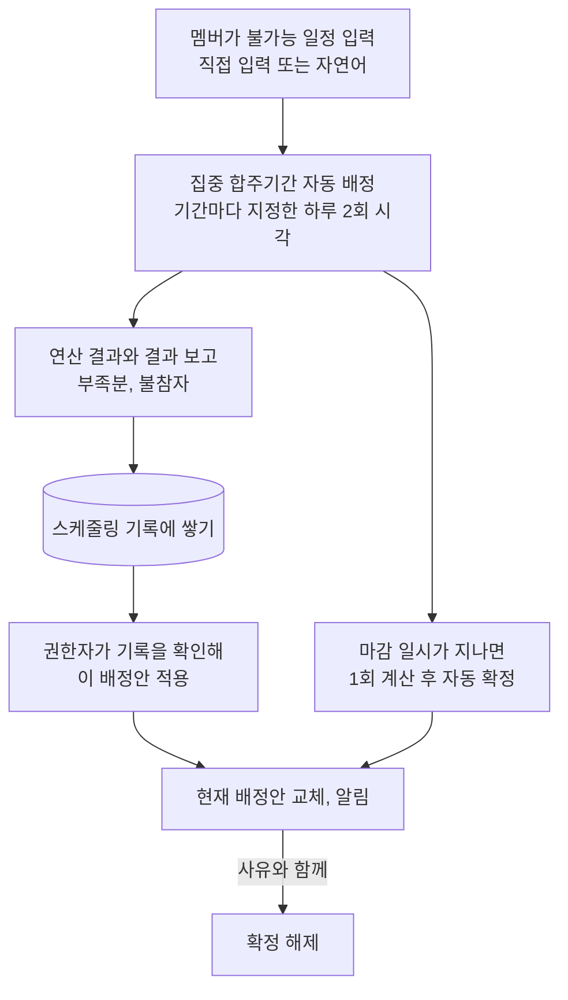

# Banblit

> 문서 버전: 1.1.0 draft

밴드의 공용 합주실 일정을, 멤버가 "사용할 수 없는 시간"만 등록하면 자동으로 배정해주는 합주 일정 관리 서비스입니다.

## Abstract

Banblit은 1개의 합주실을 2개 이상의 밴드 팀이 함께 사용할 때 발생하는 일정 충돌을 줄이기 위해 만든 서비스입니다. 각 멤버는 합주에 참여할 수 없는 시간만 등록하면 되고, 집중 합주기간에는 시스템이 등록된 불가능 일정을 모아 팀별 합주 시간을 자동으로 배정합니다. 연산 결과는 스케줄링 기록에 쌓이고, 권한자가 기록을 확인해 적용하거나 기간의 마감 일시가 지나 자동으로 확정되어야 현재 배정안이 됩니다.

## 배경

밴드 팀들이 1개의 합주실을 공유할 때 팀 간 시간이 자주 겹칩니다. 특히 한 사람이 2개 이상의 팀에 속해 있으면 그 사람의 일정이 한 번 변경되는 것만으로도 그 사람이 속한 모든 팀의 일정이 연쇄적으로 영향받고, 연쇄 변경을 수동으로 조정하는 작업이 가장 큰 병목입니다.

Banblit은 일정 조정 작업의 자동화를 목표로 합니다.

## 핵심 흐름



자동 배정은 팀마다 목표 시간까지, 가장 적게 받은 팀부터 최대한 배정합니다. 불참 허용 인원 안에서 빠지는 멤버가 있는 시간도 쓰되, 멤버가 등록한 불가능 일정을 임의로 무시하지 않습니다. 결과는 항상 나오고, 목표보다 적게 받은 팀(부족분)과 빠지는 멤버(불참자)는 결과 보고로 함께 표시됩니다.

연산 결과는 현재 배정안을 바로 변경하지 않고 스케줄링 기록에 쌓입니다. 권한자가 기록을 열어 적용하거나, 기간에 지정한 마감 일시가 지나 1회 계산 후 자동으로 확정되어야 현재 배정안이 됩니다. 확정은 권한자가 사유와 함께 해제할 수 있습니다.

## 주요 기능

- **캘린더 스케줄러** — 월 보기는 3가지 모드(전체 팀 일정 / 합주실 예약 / 내 일정)를 탭으로 전환하고, 주 보기는 모든 팀의 하루 일정을 시간 순서로 표시합니다.
- **자동 배정** — 집중 합주기간 동안 모든 팀이 비슷한 합주량을 갖도록 합주 시간을 배정합니다.
- **자연어 입력(예정)** — "다음 주 화요일 저녁은 사용할 수 없어" 같은 표현을 사용 불가능 일정으로 등록, 수정, 삭제합니다.
- **결과 보고와 확정** — 연산마다 부족분과 불참자를 보고하고, 권한자의 적용 또는 마감 일시의 자동 확정으로 현재 배정안을 결정합니다.
- **상시 예약** — 집중 합주기간이 아닐 때는 선착순으로 합주실을 예약하고, 취소, 변경할 수 있습니다.
- **팀 게시판과 공지** — 팀마다 게시글과 파일을 공유하는 게시판을 두고, 공지는 전체에게 공개합니다.
- **권한 세트** — 팀, 합주실, 기간, 스케줄링 기록 확정, 공지 등 권한 항목 23개를 활성화하고 비활성화하는 권한 세트로 할 수 있는 일을 결정합니다.

## 역할

- **권한 세트를 가진 멤버** — 팀 생성, 멤버 관리, 합주실과 운영 시간 설정, 집중 합주기간과 계산 시각 지정, 스케줄링 기록 확정과 확정 해제, 공지 발행, 권한 세트 정의 중 활성화된 항목을 담당합니다. 인원은 고정하지 않습니다.
- **일반 멤버** — 자신의 사용 불가능 일정을 관리하고, 팀에 참가하며, 일정을 확인합니다.

## 기술 스택

| 구분 | 사용 기술 |
| --- | --- |
| 프론트엔드 | React + Vite + TypeScript |
| 백엔드 | Python + FastAPI |
| 데이터베이스 | PostgreSQL |
| 자연어 처리 | Claude API (연동 예정) |

## 실행

모든 실행은 container(Docker 가 격리해 실행하는 환경) 안에서 이루어집니다. 호스트에는 Docker만 필요합니다.
개별 `docker compose` 명령의 의미와 주의점은 `COMMAND.md` 에 작성되어 있는 내용을 기준으로 합니다.

### 개발 (Windows)

```
.\banblit.ps1 setup     # 한 번만. banblit 명령을 PowerShell 에 등록합니다
banblit up
```

화면은 `http://localhost:5173`, API 문서는 `http://localhost:8000/docs`입니다.
`banblit help`로 나머지 명령을 확인합니다.

### 배포 (Linux 서버)

```
curl -fsSL https://get.docker.com | sh
sudo usermod -aG docker $USER      # 그리고 다시 로그인
git clone https://github.com/minkong-dev/Banblit.git
cd Banblit
cp .env.example .env
nano .env                          # 아래 표의 값을 입력합니다
./banblit.sh up
```

`./banblit.sh up`은 Docker image(container 를 생성하는 원본 파일)를 생성하고, migration(데이터베이스 구조 변경 이력)을 적용하며, 전체 서비스를 시작한 후
응답을 기다립니다. 성공하면 `~/.bashrc`에 `banblit` function 을 추가하므로 성공 이후로는
`./` 없이 어느 경로에서나 실행합니다.

`.env`에서 반드시 입력해야 하는 값입니다. 비어 있으면 시작 전에 멈춥니다.

| 값 | 용도 |
| --- | --- |
| `BANBLIT_DOMAIN` | 서비스 주소. 이 이름으로 인증서를 받으므로 실제로 이 서버를 가리켜야 합니다 |
| `POSTGRES_PASSWORD` | 데이터베이스 비밀번호. 견본 값 그대로면 거절합니다 |
| `SMTP_*` | 비밀번호 재설정, 계정명 찾기 메일을 발송할 계정. 비어 있으면 메일이 발송되지 않습니다 |
| `APP_ORIGIN` | 메일에 포함할 링크의 접두사. 배포에서는 `https://<도메인>` |
| `ADMIN_SIGNUP_CODE` | 관리자코드. 가입할 때 이 값을 보낸 계정만 권한 항목을 전부 받습니다. 첫 관리자는 이 값으로 가입합니다 |

Cloudflare를 사용한다면 `BANBLIT_DOMAIN` 의 DNS 레코드만 프록시를 비활성화하거나(DNS only) 프록시 모드를
Full(strict)로 설정합니다. 2가지 중 어느 것도 하지 않으면 인증서 발급이 차단됩니다.

## 현재 상태

v1 기획을 확정하고 구현했습니다. 합주실, 기간, 팀, 명단, 예약, 사용 불가능 일정, 게시판, 
알림, 권한과 자동 배정까지 동작하며, 화면 12개가 서버와 통합되어 있습니다.
Claude API 연동과 소셜 로그인은 미구현입니다.

배포 구성(reverse proxy(caddy), 정기 백업, 요청 제한)은 실제 서버에서 운영 중입니다.

## 라이선스

[LICENSE](./LICENSE) 파일을 따릅니다.
